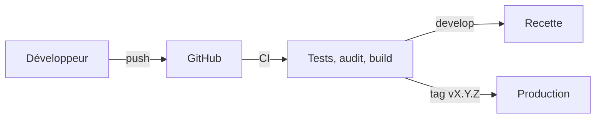

# CESIZen : l'application de votre santé mentale

Monorepo du projet CESIZen (Bloc 3 CDA, Maxime Gervilla).

| Dossier | Contenu |
|---|---|
| `apps/api` | API REST Node.js / Express / TypeScript / Prisma / MySQL |
| `apps/web` | Back-office d'administration React / Vite |
| `apps/mobile` | Application mobile Expo / React Native |
| `infra` | Docker Compose de déploiement (recette, production) |
| `.github` | CI/CD GitHub Actions, modèles de tickets, Dependabot |

Voir `CONTRIBUTING.md` (règles), `SECURITY.md` (sécurité) et `CHANGELOG.md` (versions).
